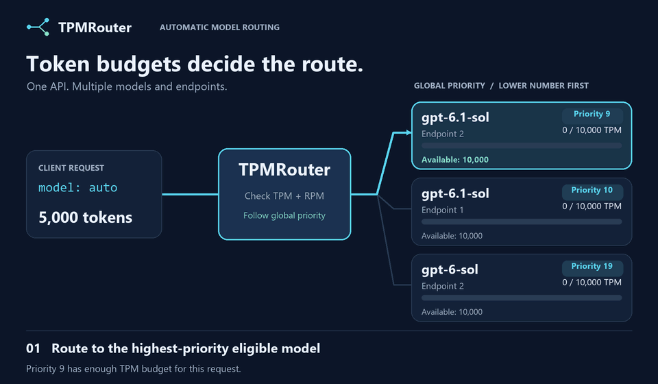

# TPMRouter

TPMRouter is an ASP.NET Core (.NET 10) web API that sits in front of multiple Azure OpenAI resources, each with its own deployments and credentials. Clients use the OpenAI-compatible Responses API for text, reasoning, and function calling. The router picks an eligible deployment with token budget and returns its response.

With `model: "auto"`, the router chooses from configured deployments across all endpoints based on their tokens-per-minute (TPM) and requests-per-minute (RPM) limits. An explicit model must match a configured deployment's `Model` exactly (case-sensitive) and restricts routing and failover to deployments with that alias, including deployments on different endpoints. `Name` identifies the actual Azure deployment; it can differ from `Model`.



The animation uses illustrative effective token budgets. Each request reserves estimated input and output tokens; lower priority numbers are preferred globally across endpoints.

## How it works

1. The router validates the client API key and request format.
2. It estimates tokens for each eligible deployment using the `o200k_base` tokenizer. Responses includes full `input` history, instructions, tool definitions, and structured output schemas, plus the requested output limit (or the deployment's `MaxOutputTokens` when omitted). Chat Completions includes all messages and schemas, plus `n` times its output limit.
3. It selects a deployment from those that are not in cooldown and have enough TPM and RPM left in the last 60 seconds:
   - lowest `Priority` value first, compared globally across endpoints (values may repeat),
   - then highest remaining ratio (`min(remaining TPM %, remaining RPM %)` when a local RPM limit is configured; otherwise remaining TPM %),
   - then most available TPM.
4. It reserves the estimate and calls the deployment with the `OpenAI` .NET SDK through the Azure OpenAI `/openai/v1/` endpoint, using the deployment name as the model (SDK retries are disabled).
5. It updates its budget from the `x-ratelimit-remaining-tokens` and `x-ratelimit-remaining-requests` response headers.
6. Before the response starts, an upstream `429`, `500`, `502`, `503`, `504`, connection failure, or per-attempt timeout puts the deployment in cooldown and triggers another eligible attempt, within the request deadline. Other upstream status codes are returned without retry. Streaming requests can fail over only before any response has been sent; a failed stream is aborted after that point.

Budget state is kept in memory (single instance) or in Redis (multiple instances).

Each upstream attempt reserves its estimated tokens and one request for a 60-second rolling window. Reservations expire with that window; they are not reduced to the response's actual token usage or refunded on failure or cancellation. Rate-limit headers can further restrict the available budget. Budget, header snapshots, and cooldown are isolated by `(EndpointId, deployment Name)`, so different endpoints can use the same deployment name. Instances sharing a budget must use the same Redis connection, key prefix, endpoint IDs, and deployment configuration.

## Project layout

```
src/TPMRouter.Api/            Web API
  Auth/                       API key middleware
  Budget/                     Token estimator, in-memory and Redis budget trackers
  Endpoints/                  HTTP endpoint handlers
  Options/                    Configuration and validation
  Relay/                      Deployment selection, relay logic, metrics
  Upstream/                   Azure OpenAI client
tests/TPMRouter.UnitTests/
tests/TPMRouter.IntegrationTests/   WireMock.Net + Testcontainers (Redis)
```

## Configuration

Settings live under the `Relay` section of `src/TPMRouter.Api/appsettings.json`. `RelayOptions` binds this section, and `RelayOptionsValidator` validates it at startup. All TPM/RPM limits come from configuration; changing them requires an application restart, but no code change or rebuild.

| Setting | Description |
|---|---|
| `Endpoints` | Non-empty list of Azure OpenAI resources. Each resource has its own credentials and deployments. |
| `Endpoints[].Id` | Required, unique, stable endpoint ID used in budget keys, status, logs, and metrics. |
| `Endpoints[].Endpoint` | Unique HTTP/HTTPS resource root URI; the router appends `/openai/v1/`. Do not include an API path, query, or fragment. |
| `Endpoints[].ApiKey` | API key for this Azure OpenAI resource. **Secret.** |
| `ClientApiKey` | Client key for Responses and Chat Completions (Bearer). **Secret.** |
| `AdminApiKey` | Key required for `GET /relay/status`. **Secret.** |
| `SafetyFactor` | Fraction of TPM/RPM the relay may use (default `0.9`). |
| `MaxQueueWaitSeconds` | Queue-wait cutoff measured from the start of routing, also constrained by the request deadline (default `30`). |
| `ErrorCooldownSeconds` | Cooldown for retryable upstream errors and timeouts before the response starts; fallback for `429` without a retry header (default `10`). |
| `UpstreamTimeoutSeconds` | Timeout for one upstream attempt, including reading its stream (default `120`). |
| `RequestDeadlineSeconds` | Routing time budget across queue waits, attempts, and streaming, starting after validation and token estimation; must exceed `UpstreamTimeoutSeconds` (default `180`). |
| `BudgetStore` | `InMemory` (default) or `Redis`. |
| `RedisConnectionString` | Required when `BudgetStore` is `Redis`. |
| `RedisKeyPrefix` | Key prefix in Redis (default `tpmrouter`). |
| `Endpoints[].Deployments` | Non-empty list of deployments: `Name` unique within the endpoint, required public `Model` alias (`auto` is reserved), positive `TokensPerMinute`, nonnegative `RequestsPerMinute` (`0` disables the configured RPM check; upstream remaining-request headers still apply), positive `MaxOutputTokens`, and global `Priority` (lower is preferred; duplicate values are allowed). |

The application does not start if a required value is missing or invalid.

For example, two endpoints can each host multiple models. The same public model can route to different Azure deployment names:

```json
{
  "Relay": {
    "SafetyFactor": 0.9,
    "MaxQueueWaitSeconds": 30,
    "ErrorCooldownSeconds": 10,
    "UpstreamTimeoutSeconds": 120,
    "RequestDeadlineSeconds": 180,
    "ClientApiKey": "",
    "AdminApiKey": "",
    "BudgetStore": "InMemory",
    "RedisConnectionString": "",
    "RedisKeyPrefix": "tpmrouter",
    "Endpoints": [
      {
        "Id": "azure-a",
        "Endpoint": "https://resource-a.openai.azure.com/",
        "ApiKey": "",
        "Deployments": [
          {
            "Name": "gpt-5.4",
            "Model": "gpt-5.4",
            "TokensPerMinute": 150000,
            "RequestsPerMinute": 1500,
            "MaxOutputTokens": 32000,
            "Priority": 40
          },
          {
            "Name": "gpt-5.2",
            "Model": "gpt-5.2",
            "TokensPerMinute": 150000,
            "RequestsPerMinute": 1500,
            "MaxOutputTokens": 32000,
            "Priority": 50
          }
        ]
      },
      {
        "Id": "azure-b",
        "Endpoint": "https://resource-b.openai.azure.com/",
        "ApiKey": "",
        "Deployments": [
          {
            "Name": "gpt-5.4-backup",
            "Model": "gpt-5.4",
            "TokensPerMinute": 150000,
            "RequestsPerMinute": 1500,
            "MaxOutputTokens": 32000,
            "Priority": 41
          },
          {
            "Name": "gpt-5.2",
            "Model": "gpt-5.2",
            "TokensPerMinute": 150000,
            "RequestsPerMinute": 1500,
            "MaxOutputTokens": 32000,
            "Priority": 51
          }
        ]
      }
    ]
  }
}
```

Replace the example resource URIs, deployment names, and limits with your actual configuration and supply the empty keys through secret configuration. Deployments sharing a `Model` alias must provide interchangeable model behavior. The repository's `appsettings.json` keeps the existing resource under `azure-primary`; add more entries to `Endpoints` as needed.

To migrate a single-endpoint configuration, move `Relay:Endpoint`, `Relay:ApiKey`, and `Relay:Deployments` into `Relay:Endpoints:0`, assign a stable `Id`, and set each deployment's `Model` (use its existing `Name` to preserve client requests). Update user secrets and environment variables to the nested paths. The old configuration shape is no longer supported.

Redis budget keys now use `{RedisKeyPrefix}:v2:<escaped EndpointId>/<escaped deployment Name>:res`, `:snap`, and `:cool`; the shared hash tag keeps atomic routing across endpoints in one Redis Cluster slot. Existing keys are not migrated. Drain and stop old instances, let their 60-second reservation window and active cooldowns expire, then start updated instances with matching configuration. Do not run old and new versions together against production traffic: they would account for budgets independently. Keep endpoint IDs stable after migration to preserve budget state.

Do not store secrets in `appsettings.json`. For development use user secrets:

```powershell
cd src/TPMRouter.Api
dotnet user-secrets set "Relay:Endpoints:0:Endpoint" "https://<resource>.cognitiveservices.azure.com/"
dotnet user-secrets set "Relay:Endpoints:0:ApiKey" "<azure-openai-key>"
dotnet user-secrets set "Relay:ClientApiKey" "<client-key>"
dotnet user-secrets set "Relay:AdminApiKey" "<admin-key>"
```

Keep each endpoint's `Endpoint` and `ApiKey` empty in `appsettings.json`. Supply runtime values through environment variables:

- `Relay__Endpoints__0__Endpoint` and `Relay__Endpoints__0__ApiKey` for the first endpoint.
- `Relay__Endpoints__1__Endpoint` and `Relay__Endpoints__1__ApiKey` for the second endpoint.
- `Relay__ClientApiKey` and `Relay__AdminApiKey` for API authentication.

Array indexes start at zero and must match the endpoint order in `appsettings.json`. Environment variables override the empty JSON values. Model, TPM/RPM, and priority settings remain in `appsettings.json`.

## Run

```powershell
dotnet run --project src/TPMRouter.Api
```

The default `http` launch profile uses `http://localhost:5042`. The `https` profile (`--launch-profile https`) also exposes `https://localhost:7088`. Use the listening addresses printed at startup if you override these settings.

## API

### Usage history

The status page links to **使用量歷史** (`/usage-history.html`). Enter the existing `Relay:AdminApiKey` to load records. The page defaults to the last seven calendar days including today, supports a custom inclusive date range in the browser's local time zone, and displays 50 records per page, newest first.

Requests to both inference endpoints are recorded in SQLite, including authentication failures, validation errors, and partial streaming responses. Each record contains the request's UTC timestamp, connected source IP, source text, complete tool definitions, returned tool calls with arguments, actual input/output token counts, and output text. Streaming Chat Completions requests ask upstream to include usage; missing upstream counts are stored as `NULL`, rather than estimated. Function calls represent calls requested by the model; the router does not execute tools. API keys and request headers are not recorded.

The database is created at `data/usage-history.db` relative to the API content root, outside `wwwroot`, and uses WAL. Override `UsageHistory:DatabasePath` (environment variable `UsageHistory__DatabasePath`) to place it on persistent storage. Seven days is a display filter; older records remain in the database. SQLite write failures are logged without replacing the inference response.

`GET /relay/usage-history` requires `X-Api-Key: <admin-key>` and accepts optional ISO 8601 `start` and `end` timestamps plus a positive `page`. The start is inclusive and the end exclusive; omitted timestamps default to the last seven days. The JSON response contains `items`, `totalCount`, `page`, and `pageSize`. The browser keeps the entered key only in the current page.

Responses and Chat Completions require `Authorization: Bearer <client-key>`. `/relay/status` requires `X-Api-Key: <admin-key>`.

The inference API exposes `POST /v1/responses` and `POST /v1/chat/completions`. The former `POST /relay` endpoint has been removed and returns `404`.

### `POST /v1/responses`

Use the [Responses API format](https://developers.openai.com/api/docs/guides/migrate-to-responses) for reasoning and function calling. No `api-version` query parameter is required. For `gpt-6.1-sol`, tool calling requires Responses; Chat Completions tool calling and `reasoning_effort: "none"` are unsupported, as documented in the [model guide](https://developers.openai.com/api/docs/models/gpt-6.1-sol).

```bash
curl "http://localhost:5042/v1/responses" \
  -H "Content-Type: application/json" \
  -H "Authorization: Bearer <client-key>" \
  -d '{"model":"auto","input":[{"role":"user","content":"Look up the weather in Taipei."}],"reasoning":{"effort":"medium"},"max_output_tokens":2000,"store":false,"include":["reasoning.encrypted_content"],"tools":[{"type":"function","name":"get_weather","description":"Get current weather for a city.","parameters":{"type":"object","properties":{"city":{"type":"string"}},"required":["city"],"additionalProperties":false},"strict":true}],"tool_choice":"auto"}'
```

`model` and `input` are required. `input` accepts a text string or a non-empty array of input items, including text messages, reasoning items, `function_call`, and `function_call_output`. Image, audio, and file content parts are unsupported. Use `max_output_tokens` and `reasoning: {"effort": "medium"}` instead of Chat Completions fields. Function tools use top-level `name`, `parameters`, and `strict`, without the Chat Completions `function` wrapper. Remaining options are forwarded unchanged; the selected upstream deployment must support Responses and the requested options.

The router uses the same global priorities, rolling TPM/RPM budgets, cooldowns, and failover as Chat Completions. Both APIs share each deployment's budget. It replaces `model` with the selected deployment name and supplies `max_output_tokens` from `MaxOutputTokens` when omitted. An explicit output limit excludes deployments whose cap is smaller; the limit is never silently reduced. Estimates include instructions, all input items and tool results, tools, and `text` output schemas.

The complete upstream response is preserved, including `output`, function arguments, reasoning items, usage, and response status. To continue a function call, execute each returned `output` item whose `type` is `function_call` in the client. Append **all** returned output items to your existing input history, including reasoning items, then append `{"type":"function_call_output","call_id":"<returned-call-id>","output":"<tool-result>"}` for each call and send the full history to `/v1/responses` again with `model: "auto"`. With `store: false`, request `include: ["reasoning.encrypted_content"]` and preserve that content when replaying reasoning history.

Each request must carry its full history so the router can estimate its token budget and route across endpoints. `previous_response_id`, `conversation`, stored `item_reference` inputs, and `background: true` return `400`. Retrieval and conversation-management endpoints are not exposed. Use synchronous requests or `stream: true`.

Streaming preserves native Responses SSE events, including function argument deltas and `response.completed`, `response.incomplete`, or `response.failed`; it does not add the Chat Completions `[DONE]` marker. A missing terminal event, timeout, or cancellation aborts the stream after it starts, without switching deployments. Errors before streaming starts use the same OpenAI-compatible error format and status codes as Chat Completions.

OpenAI SDK clients can set their base URL to `https://<router-host>/v1/` and use `ClientApiKey`. For the pinned OpenAI .NET SDK:

```csharp
using System.ClientModel;
using OpenAI.Responses;

#pragma warning disable OPENAI001 // ResponsesClient is experimental in this SDK version.

ResponsesClient client = new(new ApiKeyCredential("<client-key>"), new ResponsesClientOptions
{
    Endpoint = new Uri("https://<router-host>/v1/"),
});
CreateResponseOptions options = new() { Model = "auto", StoredOutputEnabled = false };
options.InputItems.Add(ResponseItem.CreateUserMessageItem("Hello"));
ResponseResult response = await client.CreateResponseAsync(options);
Console.WriteLine(response.GetOutputText());
```

### `POST /v1/chat/completions`

This endpoint follows the [OpenAI Chat Completions request and response format](https://developers.openai.com/api/reference/resources/chat/subresources/completions/methods/create). No `api-version` query parameter is required.

```bash
curl "http://localhost:5042/v1/chat/completions" \
  -H "Content-Type: application/json" \
  -H "Authorization: Bearer <client-key>" \
  -d '{"model":"auto","messages":[{"role":"developer","content":"You are helpful."},{"role":"user","content":"Hello"}],"max_completion_tokens":200}'
```

Both `model` and a non-empty `messages` array are required, with `Content-Type: application/json`. Supported roles are `system`, `developer`, `user`, `assistant`, `tool`, and the legacy `function` role. The default is one choice (`n: 1`) and a non-streaming response (`stream: false`); `n` and any supplied token limit must be positive integers.

The endpoint supports text strings and text content parts, assistant refusal parts, multi-turn conversations, tool calls and tool results, structured output, multiple choices, and streaming. Assistant content may be omitted or null when a tool call, function call, or refusal is present. Image, audio, and file content parts are rejected with `400`; audio output is also unsupported. Remaining options are forwarded unchanged, and support depends on the selected upstream model. A non-retryable upstream parameter error is returned to the client without trying another model.

The router forwards the request JSON, replacing `model` with the selected deployment name. If neither `max_tokens` nor `max_completion_tokens` is provided, it supplies the deployment's configured `MaxOutputTokens` as `max_completion_tokens`. Specify at most one token-limit field. An explicit limit above a deployment's configured cap excludes that deployment; if no eligible deployment supports the limit, the request returns `400`. Limits are never silently reduced.

The complete upstream response is preserved, including `id`, `object`, `created`, `model`, all `choices`, nullable content, `tool_calls`, `finish_reason`, usage details, and additional response fields. The response `model` is the upstream model, not the `auto` alias.

For streaming, set `stream: true`. The response uses `text/event-stream`, preserving upstream chunks and `data: [DONE]`. Set `stream_options: {"include_usage": true}` to request the final usage chunk. Once streaming starts, its HTTP status remains `200`; cancellation, timeout, or a stream ending before `[DONE]` closes the connection without switching deployments, appending a successful terminator, or writing a JSON error body. Failures before streaming starts use the error responses below.

OpenAI SDK clients can set their base URL to `https://<router-host>/v1/` and use `ClientApiKey` as the API key. For example, with the OpenAI .NET SDK:

```csharp
using System.ClientModel;
using OpenAI;
using OpenAI.Chat;

ChatClient client = new("auto", new ApiKeyCredential("<client-key>"), new OpenAIClientOptions
{
    Endpoint = new Uri("https://<router-host>/v1/"),
});
ChatCompletion completion = await client.CompleteChatAsync([new UserChatMessage("Hello")]);
Console.WriteLine(completion.Content[0].Text);
```

The router does not impose a JSON character-count limit. It estimates input and output tokens, then selects a deployment with enough remaining TPM and RPM according to global priority. If none has capacity now, it waits within `MaxQueueWaitSeconds` or returns `429` with `Retry-After`. If the estimate exceeds every eligible deployment's total usable TPM (`TokensPerMinute × SafetyFactor`), it returns `413` because no deployment can fit the request even with an empty rolling window.

Errors before the response starts use `{ "error": { "message": "...", "type": "...", "param": null, "code": "..." } }`; `param` identifies the invalid field when available. Invalid JSON, content type, or parameters return `400`, invalid Bearer keys return `401`, unknown models return `404`, token estimates that cannot fit return `413`, full eligible deployments return `429` with `Retry-After`, and upstream failures or timeouts return `502` or `504`. Non-retryable upstream errors retain their status and error details.

### `GET /relay/status`

Requires `X-Api-Key: <admin-key>`. Returns the current budget of each deployment, identified by `endpointId`, `name` (Azure deployment), and `model` (public alias): reserved tokens, requests in the window, available TPM/RPM, the last rate-limit header values, and cooldown end time. The response remains a flat array, so deployments with the same name can be distinguished by their endpoint ID.

Missing or incorrect admin keys return `401` with an empty response body.

### `GET /healthz`

Liveness check. No key required; it does not probe Azure OpenAI or Redis connectivity.

### `GET /`

English dashboard showing reported input + output tokens and rate-limit reservations as separate TPM bars, with a third bar for RPM attempts. Each metric uses a 60-second rolling window per endpoint and deployment. Reported tokens include usage returned by successful and failed upstream attempts, including retries and interrupted streams when usage was received; missing usage contributes no tokens and produces no additional message. Reservations remain until expiry and are not reduced to actual usage. Redis shares both token counters across instances. Available routing budgets are separately labeled and constrained by SafetyFactor and Azure rate-limit response headers. The footer links to [Azure OpenAI: Understanding rate limits](https://learn.microsoft.com/en-us/azure/foundry/openai/how-to/quota?tabs=python#understanding-rate-limits). Azure's internal token estimate and short RPM evaluation windows are not reproduced exactly. Open `http://localhost:5042/` without an API key. JavaScript fetches `/relay/dashboard/status` immediately and every 10 seconds; its `actualTokens` field contains reported usage, while `reservedTokens` and `requestsInWindow` retain their rate-limit meaning. Failed refreshes label displayed data as stale.

## Telemetry

The relay exports OpenTelemetry metrics from the `TPMRouter` meter: `relay.reserved_tokens`, `relay.upstream_429`, and `relay.selected_deployment`. These are counters tagged by `endpoint` (the configured ID) and `deployment` (the Azure deployment name); reserved tokens and selected deployments are counted per upstream attempt, including retries across endpoints. Selection and failure logs identify the endpoint/deployment pair. Set `Telemetry:ConsoleExporter` to `true` to print logs and metrics to the console (enabled in `appsettings.Development.json`). Application logs do not include prompt or response content.

## Tests

```powershell
dotnet test TPMRouter.slnx
```

The integration tests use WireMock and a local HTTP server for upstream behavior, exercise the official OpenAI .NET SDK against the router, and need Docker for Redis containers. They cover routing across independent endpoints, credentials, global priorities, model aliases, same-named deployment isolation, failover, SSE, and shared Redis budgets across instances. They do not call a live Azure OpenAI deployment.
